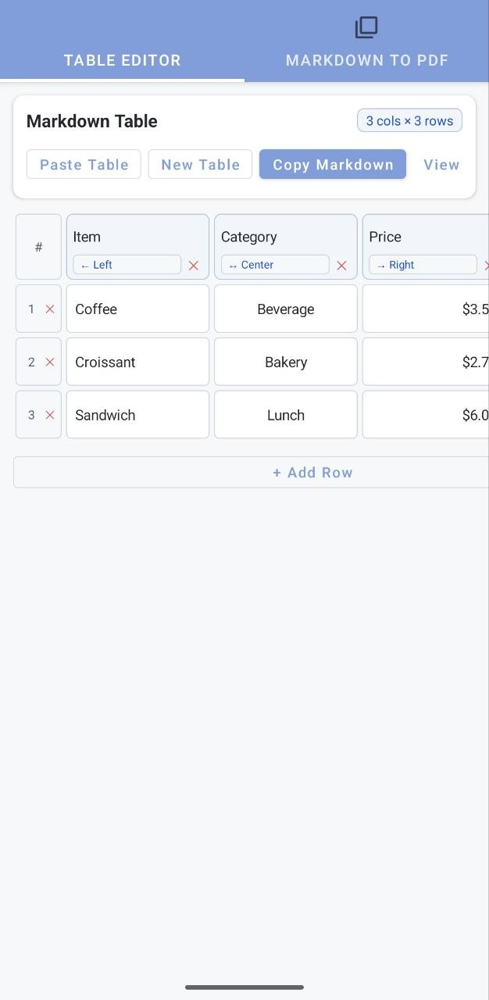
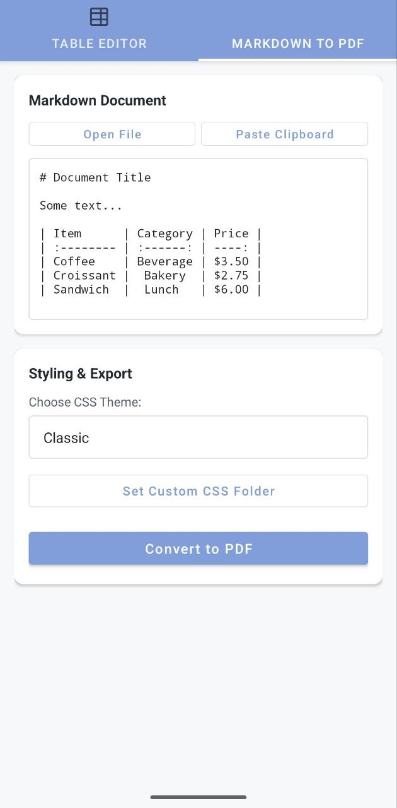
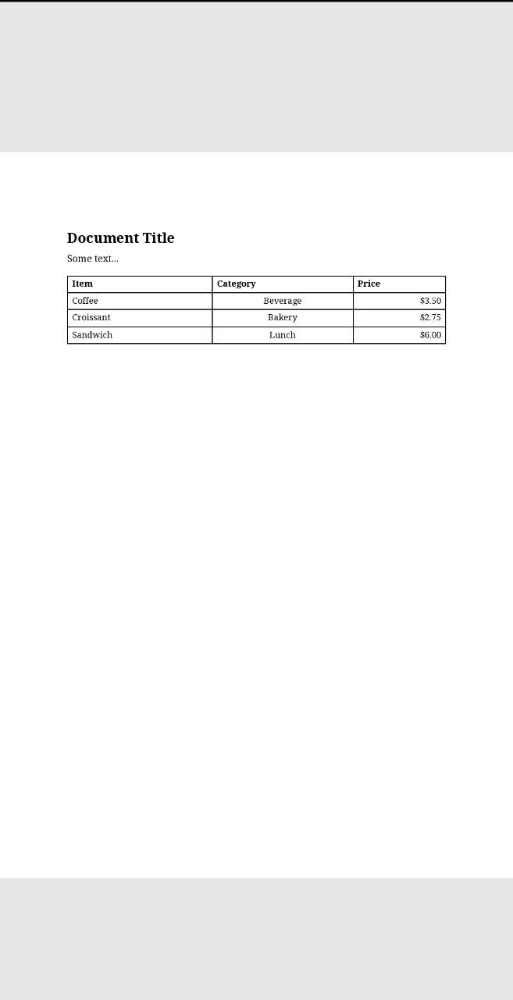

# MdTools

I have a mostly Android-centric workflow. To write, I heavily rely on markdown (using the excellent QuickEdit+ app). Yet, for sharing, markdown is not ideal. Also, typing tables by hand is tedious. So I made this up to:

- Style a markdown file with some CSS and convert to pdf
- Quickly edit tables

A markdown file can be quickly sent to the app using "send to", and the content will be immediately fed to the Convert to Pdf feature.

Also, you can specify a folder on phone from which to take additional custom CSS styles.

All in all, this app was mostly made for myself, and to expreriment with Kotlin and with the possibility to build an app without Android studio. Someone may find it useful, so I am sharing it.

## Screenshots

 